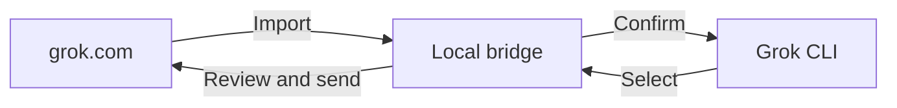

# Grok CLI ↔ Web Bridge

**Continue Grok conversations between the browser and your terminal, with a review step before sending messages to the web.**

[English](#english) · [Português](#português) · [Report a bug](https://github.com/p1v0t/grok-cli-web-bridge/issues) · [Security](SECURITY.md)

Python 3.10+ · Standard library only · Local web interface · Windows-focused terminal integration

## English

A local web interface for people who use both **grok.com** and **Grok CLI**. Browse web conversations and local CLI sessions, import a web conversation into the terminal, and preview selected CLI messages before sending them back to grok.com.

> **Status:** independent, unofficial integration using internal grok.com endpoints and Grok CLI authentication/session formats. These can change. The published edition is validated with simulated responses; it has not been validated by sending real conversations to the service.

### What you can do

| Task | How the bridge helps |
| --- | --- |
| Continue a web conversation in the CLI | Save its transcript locally and confirm before opening Grok CLI. |
| Bring selected CLI messages to the web | Review the exact outgoing text and explicitly confirm the transfer. |
| Keep planning context for a conversation | Link a CLI session and a web conversation in an isolated planning channel. |
| Ask for a next-step plan | Explicitly send a report and the channel knowledge; receive text to review in the CLI. |

### How it fits together



The web server does not expose a remote terminal. Opening a planning channel does not start an automatic execution loop.

### Quick start

**Requirements:** Python 3.10 or newer, Git to clone the repository, and Grok CLI installed and authenticated through its provider. The bridge itself uses only the Python standard library.

```sh
git clone https://github.com/p1v0t/grok-cli-web-bridge.git
cd grok-cli-web-bridge
```

On **Windows**:

```powershell
py -3 ponte.py
```

Or open `Abrir Ponte.bat`. On **Linux/macOS**, run `python3 ponte.py`; interactive terminal launching is primarily adapted for Windows.

The interface opens at **http://127.0.0.1:8765**. Use `--no-browser` to skip opening a tab. Press `Ctrl+C` in the server terminal to stop.

### Example workflow

1. Start the bridge and browse your web conversations and local CLI sessions.
2. Choose a web conversation to continue in the terminal. Review its content and confirm the import.
3. Work in Grok CLI. When you want to send selected messages back, open the bridge preview.
4. Check the exact outgoing text and confirm. If the CLI session changes after previewing, review it again.

The interface currently uses Portuguese labels. **Continuar no terminal** means continue in the terminal; **Enviar para o Grok web** means send to Grok web; **Abrir canal** means open a planning channel.

### Configuration

| Environment variable | Default | Purpose |
| --- | --- | --- |
| `GROK_HOME` | `~/.grok` | Grok CLI authentication and sessions |
| `GROK_BRIDGE_HOME` | `~/.grok-bridge` | Private channels, imports and planning knowledge |
| `GROK_BRIDGE_PORT` | `8765` | Local IPv4 loopback port |

Keep these data directories private and outside the repository. The bridge reads the CLI authentication at runtime; credentials are not included in this repository or returned to the UI.

### Privacy, limits and validation

- The server binds to `127.0.0.1`, checks Host/Origin and uses a per-start API token.
- Sending messages or planning reports transfers their contents to grok.com. Review text for secrets and personal data; automatic filtering cannot catch everything.
- Imported conversations are untrusted content. Review instructions before executing them.
- Local access controls do not protect against other software running as the same operating-system user.
- Tests use simulated responses, without real authentication or Grok requests. See [SECURITY.md](SECURITY.md) for the security policy.

Run the test suite on Windows:

```powershell
py -3 -m unittest discover -s tests -v
```

On Linux/macOS, replace `py -3` with `python3`. For planning commands and detailed safeguards, see the Portuguese reference below and [examples/PLANNER.md](examples/PLANNER.md).

### Feedback and related project

Found a problem? [Open an issue](https://github.com/p1v0t/grok-cli-web-bridge/issues) with your OS, Python version, reproduction steps and expected result. Remove tokens, private conversations and other sensitive data before posting. Follow [SECURITY.md](SECURITY.md) for security reports.

For coordination across AI providers, see [Multi-AI Hub](https://github.com/p1v0t/multi-ai-hub). Starting this bridge does not start the hub or its executors.

**License:** this publication does not include an additional software license. Public source availability alone does not grant an open-source license.

---

## Português

**Continue suas conversas do Grok entre o navegador e o terminal, revisando o texto antes de enviá-lo à web.**

[Voltar ao início](#grok-cli--web-bridge)

Ponte local para consultar conversas do grok.com e sessões do Grok CLI, importar uma conversa web para o terminal e enviar falas selecionadas à web após revisão. Inclui canais de planejamento: a conversa web sugere um próximo passo e o CLI recebe o texto. O servidor web não fornece um terminal remoto.

Edição pública independente; Python 3.10+ e biblioteca padrão. Não inclui contas, tokens, conversas, configurações privadas ou histórico de projetos.

## Começar

Instale e autentique o Grok CLI pelos canais do provedor. Depois, na pasta clonada:

```powershell
py -3 ponte.py
```

Ou abra `Abrir Ponte.bat`. No Linux/macOS, use `python3 ponte.py`; a abertura de terminal interativo foi adaptada principalmente ao Windows. A página abre em `http://127.0.0.1:8765`. `--no-browser` evita abrir uma aba. `Ctrl+C` encerra.

Este projeto usa endpoints internos do grok.com e o formato local de autenticação/sessões do Grok CLI. **Não é um SDK oficial da xAI.** Esses formatos podem mudar e não há garantia de compatibilidade futura. A validação desta edição usa respostas simuladas; não houve envio de conversas reais para testar a publicação.

## O que cada ação faz

- **Consultar:** lê o login local e consulta suas conversas na web; a página mostra também sessões locais do CLI.
- **Continuar no terminal:** salva o transcript localmente e, após confirmação, abre o Grok CLI. A conversa é conteúdo não confiável: revise instruções antes de executá-las.
- **Enviar para o Grok web:** abre uma prévia do texto exato. Só envia após autorização; se a sessão mudar depois da prévia, exige nova revisão. Omite resultados de ferramentas e não acrescenta o diretório de trabalho como metadado. Falas podem conter caminhos, código ou segredos — a omissão das ferramentas não os remove.
- **Abrir canal:** associa uma sessão a uma conversa web e grava conhecimento local. Isso não inicia um ciclo automático de execução.
- **Planejar:** envia um relatório e o conhecimento anterior daquele par à conversa web, quando explicitamente autorizado. O retorno é texto, não código executado pela ponte.

## Configuração

| Variável | Padrão | Uso |
| --- | --- | --- |
| `GROK_HOME` | `~/.grok` | Instalação, autenticação e sessões do CLI |
| `GROK_BRIDGE_HOME` | `~/.grok-bridge` | Canais, imports e conhecimento privados |
| `GROK_BRIDGE_PORT` | `8765` | Porta em IPv4 loopback |

A ponte lê `auth.json` do Grok CLI em tempo de execução. Não copia seu token para o repositório nem o devolve à interface. Canais usam uma pasta distinta por par sessão/conversa; trocar o par não reutiliza conhecimento de outra conversa.

Use diretórios privados do seu usuário, fora do repositório. No Windows, as permissões dependem das ACLs herdadas do diretório escolhido. Não coloque os dados em pastas compartilhadas ou sincronizadas publicamente. A ponte não altera a configuração de retenção do CLI; dados enviados ao grok.com passam a ser tratados pelo serviço remoto.

## Planejamento pelo CLI

Abra o canal na interface, revise o relatório e o conhecimento que será enviado e execute:

```powershell
py -3 ponte.py planejar --sessao ID-DA-SESSAO --situacao relatorio.md --confirm-web-send
```

Também aceita `--canal ID-DO-CANAL` ou `--conversa ID-DA-CONVERSA`, e um relatório pela entrada padrão. Sem `--confirm-web-send`, o envio é recusado. A opção `--conversa` envia diretamente ao ID explícito e não inclui o conhecimento de um canal.

O contrato de planejamento está em [examples/PLANNER.md](examples/PLANNER.md). Instale-o como instrução/skill no seu CLI apenas se desejar. A ponte não instala hooks globais nem modifica instruções de projetos.

## Proteções e limites

O servidor aceita somente `127.0.0.1`, valida Host/Origin e usa token aleatório por inicialização nas APIs. Requisições que alteram dados exigem JSON, origem local e confirmação. Tokens nunca seguem redirects, e autenticação só é enviada a `https://grok.com/rest/app-chat/`. Proxies de ambiente não são usados para essa conexão.

Há um bloqueio preventivo de padrões comuns de segredos em textos enviados. Ele não reconhece todos os dados confidenciais. A revisão humana do relatório, do conhecimento acumulado e da prévia continua necessária. Qualquer pessoa/processo com acesso ao mesmo usuário do sistema pode acessar seus dados; o servidor local não é uma fronteira contra software malicioso já executando na máquina.

## Testes

```powershell
py -3 -m unittest discover -s tests -v
```

Os testes não usam autenticação real nem chamam o Grok. A CI verifica Windows/Linux e segredos com Gitleaks. Veja [SECURITY.md](SECURITY.md).

Para coordenação entre provedores, veja [Multi-AI Hub](https://github.com/p1v0t/multi-ai-hub). Abrir esta ponte não inicia o hub nem seus executores.

Esta publicação não inclui uma licença de uso adicional. A publicação do código, por si só, não concede uma licença de software livre.
